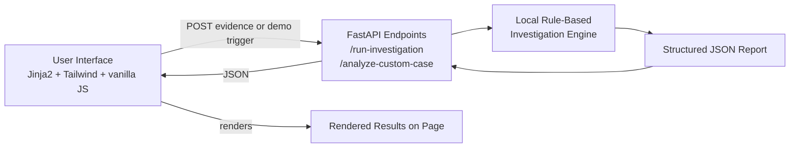

# Evidence AI

**A local, intelligent, rule-based investigation platform for internal corporate cases.**

Hackathon MVP — built for a 24-hour build window. This README is written to be
read by both technical reviewers and hackathon judges.

## Overview

Evidence AI helps HR, Compliance, Internal Audit, and Legal teams turn a pile of
scattered evidence (statements, emails, visitor logs, policy documents, meeting notes)
into a structured investigation report: extracted facts, a chronological timeline,
flagged contradictions between sources, and recommended next steps.

## Problem

Internal investigations (HR complaints, procurement fraud, policy violations,
compliance cases, data access incidents) often require a human investigator to
manually cross-reference scattered statements, emails, and records to reconstruct
what actually happened — a slow, error-prone, and inconsistent process.

## Solution

Evidence AI transforms fragmented evidence into structured facts, a timeline,
contradictions, and an investigation report, with every finding traceable back to
the exact evidence it came from.

## Target Users

- HR investigators (misconduct, harassment, policy violation complaints)
- Compliance officers (procurement, conflict-of-interest, disclosure cases)
- Internal Audit (data access incidents, control failures)
- Legal/ethics teams needing a fast first-pass structuring of raw evidence

## Current Features

- **Try Demo Investigation** — a fictional, ready-to-run procurement case with three
  evidence documents and a pre-built contradiction, so the whole flow works with one click.
- **Create New Investigation** — a form to submit your own case: title, category, report
  language, and 2–6 pieces of evidence (each with a title, type, and text).
- A **local rule-based investigation engine** that extracts people, organizations, dates,
  times, email addresses, and key claims; builds a timeline; detects contradictions
  between sources; and generates a 12-section report.
- **Source traceability** — every fact, timeline entry, and contradiction links back to
  the exact evidence document (title, type, index) it came from, with a "View Source
  Evidence" control that scrolls to and highlights that document on the page.
- **Rule Confidence** — a transparent, explainable point score (not machine-learning
  confidence) behind every detected contradiction.
- **Bilingual interface** — English/Arabic toggle for the interface, and a separate
  report-language choice that controls the generated report's own text.
- **Print / Save Report** — a print-friendly report view via the browser's native
  print-to-PDF, no PDF library involved.
- A visible **Investigation Pipeline** panel showing the (single, local) analysis
  passing through four processing stages, so the process is transparent rather than
  a black box.

## Demo Flow

1. Open the landing page. Choose **Try Demo Investigation** or **Create New Investigation**.
2. **Demo path:** the fictional `CASE-2026-104` case loads with three evidence documents
   (an employee statement, a confirmation email, and a visitor log). Click
   **Run Intelligent Investigation**.
3. **Custom path:** fill in a case title, pick a category and report language, fill in
   at least two evidence sections (or click **Load Sample Case** to reuse the demo
   text), then click **Analyze Evidence**.
4. Either way, the **Investigation Pipeline** panel steps through four stages
   (Extracting facts → Building timeline → Cross-checking evidence → Generating report)
   while the single backend call runs, then the **Investigation Report** appears below:
   executive summary, case information, involved parties, verified facts, contextual
   statements, a chronological timeline, detected contradictions (with Rule Confidence
   and "View Source Evidence"), an evidence assessment, the overall risk level,
   follow-up questions, next steps, and a disclaimer.
5. Use **Print / Save Report** to open the browser's print dialog for a clean, on-paper
   (or PDF) copy of the report.

## Architecture



## Technology Stack

- Python + FastAPI (backend, API)
- Jinja2 (server-rendered HTML templates)
- Tailwind CSS via CDN (no build step)
- Vanilla JavaScript (no framework, no bundler)
- SQLite (minimal `cases` table, reserved for future case persistence)
- Pydantic (request validation for the custom-case endpoint)

No React/Vue/Angular, no Docker, no authentication, no vector database, no
LangChain/LlamaIndex, no local or hosted LLM, and no external AI API of any kind.

## How the Local Engine Works

All analysis happens in `services/investigation_engine.py`, in a single reusable
function, `analyze_case(case)`, called both by the demo wrapper (`run_investigation()`)
and by the custom-case endpoint. There is no AI model, no LLM, and no external API call
anywhere in this file — it is regular expressions and keyword/string matching only:

1. **Fact extraction** — regex patterns pull out person names (labeled fields like
   `Visitor:`, self-identification like "I, Jordan Whitmore,", email signatures, and
   general Capitalized-name patterns), organizations (common suffixes like `Co.`,
   `Inc.`, `LLC`), dates, times, and email addresses, plus "key statements" — sentences
   containing investigative keywords (confirm, deny, no meeting, checked in, etc).
2. **Timeline building** — every dated/timed mention across all evidence is combined and
   sorted chronologically. Evidence with a date but no specific time is shown separately
   as a **Contextual Statement**, never mixed into the timed sequence.
3. **Contradiction detection** — for every document containing denial language, the
   engine checks every other document for confirmation language **on the same real
   calendar date** (dates are parsed and compared, not just string-matched, so
   "March 12, 2026", "12/03/2026", and "12 مارس 2026" are recognized as the same day).
4. **Report generation** — the findings are assembled into a 12-section report:
   executive summary, case information, involved parties, verified facts, contextual
   statements, timeline, contradictions, evidence assessment, overall risk level,
   follow-up questions, next steps, and a disclaimer.

### Rule Confidence, explained

Every detected contradiction gets a transparent, additive **Rule Confidence** score
(0–100) — this is a simple point system, **not** a machine-learning probability:

| Rule | Points |
|---|---|
| The two sources share the same real calendar date | +25 |
| The first source contains an explicit denial phrase | +20 |
| The second source contains an explicit confirmation phrase | +20 |
| The confirming source includes an exact timestamp | +20 |
| Both sources mention the same person or organization | +15 |

The score is capped at 100 and labeled **Strong** (≥80), **Moderate** (50–79), or
**Weak** (<50). The scoring logic lives in `calculate_confidence()` in
`services/investigation_engine.py`, fully commented.

### Arabic Support Scope

Arabic support is **basic keyword and pattern matching**, not full Arabic NLP:

- **Dates**: `12 مارس 2026` (Arabic month names) and `12/03/2026` (numeric, including
  Arabic-Indic digits ٠–٩).
- **Times**: `2:00 مساءً`, `1:52 م` (Arabic AM/PM markers), plus 24-hour `14:00`.
- **Denial/confirmation phrases**: a fixed list of common phrases (e.g. `لم يحدث اجتماع`,
  `لا أتذكر`, `تم تأكيد الاجتماع`, `دخل المبنى`) checked via case-insensitive substring
  matching — the same mechanism used for English.
- **Person/organization names are not extracted from Arabic text.** The English name
  patterns rely on Latin capitalization, which Arabic script doesn't have. If a name
  can't be reliably identified, the engine does not invent one — it is simply omitted.

This is an intentional, honest limitation, not a bug: the goal was transparent,
explainable bilingual date/time/claim detection, not a full Arabic NLP system.

## Privacy and Ethics

- Evidence submitted through **Create New Investigation** is processed **entirely in
  memory** and is **not written to disk or the database** in this phase.
- No evidence text is ever sent to an external service of any kind — all analysis is
  local Python code in this repository.
- A visible privacy notice on the custom-investigation page asks users not to submit
  real confidential company data into this public MVP.
- The generated report always includes a human-review disclaimer (in the chosen report
  language): *"This report is a decision-support tool. It does not determine guilt,
  liability, or disciplinary action. All findings must be reviewed by an authorized
  human investigator."*
- This is a hackathon MVP, not a security-audited product — see Limitations below.

## Limitations

- Fact extraction is regex/keyword-based. It will miss facts phrased in unexpected
  ways and can occasionally misfire on ambiguous text — it does not "understand"
  language the way a human or an LLM would.
- Contradiction detection only recognizes a specific pattern: an explicit denial in one
  source vs. an explicit confirmation in another, sharing a calendar date. It will not
  catch contradictions that don't fit this shape.
- Arabic support covers dates, times, and a fixed list of denial/confirmation phrases
  only — no Arabic name/organization extraction, and no general Arabic sentence
  understanding.
- Submitted custom-case evidence is not persisted (by design, for privacy) — closing
  the page loses the case.
- No authentication, no multi-user support, no file upload/OCR in this phase.
- This has not undergone a security audit; do not deploy it with real confidential data.

## Future Improvements

- Optional LLM-assisted fact extraction (Anthropic API) as an upgrade path, kept
  clearly separate from and honestly labeled against the current rule-based engine.
- Document upload (PDF/DOCX) with text extraction.
- Persisted case history and multi-case search, with authentication.
- Expanded Arabic name/organization recognition.

## Honest Technical Note

**No external LLM or AI API is used anywhere in this application today.** The engine
described above is a transparent, rule-based Python program — regular expressions and
keyword matching — chosen deliberately so every finding in a report can be traced back
to the exact rule and evidence excerpt that produced it. It is accurately described as:

- A **local intelligent investigation engine**
- **Rule-based evidence analysis**
- An **AI-ready investigation architecture** (i.e., structured to plug in a real model later)
- **Transparent evidence cross-checking**

It is *not* Claude-powered, LLM-powered, a multi-agent AI system, or a machine-learning
model, and the interface avoids implying otherwise (e.g. the pipeline panel is labeled
"Investigation Pipeline", not "Multi-Agent System").

## Local Installation and Run Instructions

1. Create and activate a virtual environment:
   ```
   python -m venv .venv
   .venv\Scripts\activate
   ```
2. Install dependencies:
   ```
   pip install -r requirements.txt
   ```
3. Run the application:
   ```
   uvicorn main:app --reload
   ```
   For a deployment-style run (binds all interfaces, matches the documented
   production start command):
   ```
   uvicorn main:app --host 0.0.0.0 --port 8000
   ```
   Alternatively, `python main.py` also works and reads a `PORT` environment
   variable if one is set (useful on hosting platforms that assign a port
   automatically) — otherwise it defaults to 8000.
4. Open your browser at:
   ```
   http://127.0.0.1:8000
   ```
5. Health check (useful for deployment platforms): `GET /health` → `{"status": "ok"}`

## Hackathon Context

Built end-to-end (architecture, backend, rule-based engine, bilingual frontend) within
a 24-hour hackathon build window, in three phases: project foundation, the rule-based
investigation engine, and this competition-ready expansion (custom cases, source
traceability, confidence scoring, bilingual support, printable reports).

## Ethical Disclaimer

Evidence AI assists human investigators and does not make legal or disciplinary
decisions. All output is intended to support, not replace, human judgment in corporate
investigations.
